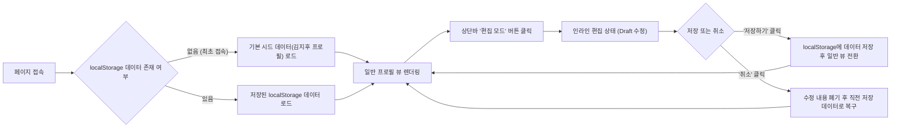

# 마이링크 (MyLink) — 프로필 페이지 기능 정의서 (PRD)

> **문서 버전**: v1.1 (Step 1: LocalStorage 기반 프로필 페이지 MVP)  
> **작성일**: 2026-11-14  
> **기반 프로젝트**: `mylink` (Next.js 16.4.6 · React 19.3.0 · Tailwind CSS 4 · TeamSparta Stack Design System)

---

## 1. 프로젝트 개요 및 현재 단계 범위 (Overview & Scope)

### 1.1 배경 및 목적
**마이링크(MyLink)**는 현재 정적 화면으로 구현된 크리에이터 프로필 페이지([`src/app/page.tsx`](file:///c:/Users/kimmi/Desktop/My-link-2502351/mylink/src/app/page.tsx))를 기반으로, **별도의 백엔드 서버나 복잡한 대시보드 없이 브라우저 로컬 스토리지(`localStorage`)를 활용해 프로필·역량·채널 링크를 화면에서 바로 편집하고 유지할 수 있는 개인용 링크 허브 웹앱**입니다.

### 1.2 현재 단계 (In-Scope) vs 향후 단계 (Out-of-Scope)
단계별 학습 및 구현을 위해 현재 PRD는 **프로필 페이지 본연의 기능과 로컬 스토리지 연동**에만 집중합니다.

| 구분 | 포함 기능 (현재 단계 집중) | 제외 기능 (향후 단계로 보류) |
| :--- | :--- | :--- |
| **핵심 범위** | - 메인 프로필 페이지 렌더링 ([`src/app/page.tsx`](file:///c:/Users/kimmi/Desktop/My-link-2502351/mylink/src/app/page.tsx) 기반)<br>- 인라인 편집 모드 전환 (`편집 모드` ↔ `일반 뷰`)<br>- 프로필 / 디자이너 노트 / 스킬·진행률 / 채널 링크 수정<br>- **`localStorage` 기반 데이터 영구 저장 및 초기값 복원**<br>- 라이트 / 다크 모드 수동 전환 토글 (`localStorage` 연동) | - 별도 관리자 대시보드 페이지 (`/admin`)<br>- 방문자 조회수·링크 클릭수 등 통계 대시보드<br>- 백엔드 API Route 및 외부 DB / 서버 파일 저장소<br>- 복잡한 회원가입 / 로그인 인증 시스템 |

---

## 2. 핵심 사용자 플로우 (User Flow)



---

## 3. 상세 기능 요구사항 (Functional Requirements)

### 3.1 글로벌 상단바 (Topbar) · 푸터 & 테마·편집 제어
1. **최상단 헤더(Topbar) 및 이름·문의하기 버튼 탭 배경 구성 (FR-TOPBAR-01)**
   - 상단 고정 바(`header`)에는 반투명 블러 배경(`bg-white/95 backdrop-blur-md dark:bg-neutral-900/95`)과 하단 1px 보더(`border-slate-200/90`)를 적용합니다.
   - 상단바 좌측의 **프로필 이름 탭(`JH · 김지후 | Creator Profile`)**과 우측의 **상태 뱃지 및 문의하기 버튼 탭(`문의하기`)**에 각각 캡슐형(`rounded-full`) 배경(`bg-slate-100/90 border border-slate-200/90 dark:bg-neutral-800/90`)을 추가하여 시각적 구분감을 높입니다.
2. **라이트 / 다크 모드 수동 전환 토글 (FR-THEME-01)**
   - 상단바 우측(`[상태 뱃지]`와 `[문의하기]` 버튼 사이)에 테마 전환 버튼(`☀️/🌙` 아이콘)을 배치합니다.
   - 선택한 테마는 `localStorage`(`mylink_theme`)에 저장되며, `<html class="dark">` 속성을 통해 Tailwind CSS `dark:` 유틸리티 클래스가 즉시 반영됩니다.
3. **푸터 편집 모드 진입 및 상단 저장/취소 제어 (FR-EDIT-01)**
   - 방문자 화면에서는 시선을 방해하지 않도록 **하단 푸터(Footer) 우측**에 작고 조용한 **`[⚙️ 편집]` 버튼**을 배치합니다.
   - 편집 모드 진입 시 상단바에 **`저장하기`**, **`취소`**, **`초기값으로 리셋`** 컨트롤 버튼이 활성화됩니다.
   - 편집 중 수정한 내용은 임시 상태(`draftData`)에 반영되며, **`저장하기`**를 누르면 `localStorage`(`mylink_profile_data`)에 일괄 저장됩니다.
   - **`취소`**를 누르면 수정 중이던 내용을 버리고 직전 저장 상태로 되돌아갑니다.
   - **`초기값으로 리셋`**을 누르면 `localStorage` 데이터를 초기화하고 기본 김지후 프로필 시드 데이터로 복구합니다.

---

### 3.2 좌측 컬럼: 메인 프로필 카드 & 디자이너 노트 편집
1. **배너 및 아바타 이미지 변경 (FR-PROF-01)**
   - 편집 모드에서 배너 이미지와 아바타 이미지 클릭 시 이미지를 변경할 수 있습니다.
   - 별도 서버 없이 동작하도록 **① 외부/로컬 이미지 URL 입력** 또는 **② 이미지 파일 선택(`FileReader`를 통한 Data URL 변환 후 `localStorage` 저장)** 방식을 지원합니다.
2. **프로필 기본 정보 인라인 수정 (FR-PROF-02)**
   - **뱃지 텍스트 및 컬러 톤**: 카드 상단(`ACTIVE 2026`), 배너(`CREATIVE STUDIO`), 아바타 옆(`VIBE CODER`), 직군(`CREATIVE DESIGNER & BUILDER`) 뱃지의 문구와 컬러 톤(`red`, `teal`, `green`, `blue`, `neutral`) 수정.
   - **이름 및 소개**: 한글 이름(`김지후`), 영문 이름(`Kim Ji-hoo`), 자기소개 본문 수정.
3. **3단 요약 지표 수정 (FR-PROF-03)**
   - `ROLE` (`Creator`) / `FOCUS` (`Vibe Coding`) / `GROWTH` (`85%`) 3개 항목의 라벨과 값을 수정할 수 있습니다.
4. **주요 행동 버튼(CTA) 및 디자이너 노트 수정 (FR-PROF-04)**
   - 상단바 문의하기 버튼 및 프로필 카드 하단 2개 CTA 버튼(`작업물 살펴보기`, `협업 제안하기`)의 문구와 링크(`href`) 수정.
   - 좌측 하단 **디자이너 노트(`DESIGNER NOTE`)**의 인용구 본문 문구 수정.

---

### 3.3 우측 섹션 1: 보유 역량 및 학습 현황 (`01 · TOOLKIT & PROGRESS`) 편집
1. **스킬 Pill 태그 관리 (FR-SKILL-01)**
   - 편집 모드에서 새 스킬 태그(스킬명 + 5가지 컬러 톤 중 선택)를 **추가**하거나, 기존 스킬 태그를 **수정/삭제(`×`)**할 수 있습니다.
2. **학습/프로젝트 진행률 카드 수정 (FR-SKILL-02)**
   - 진행 상태 뱃지(`진행 중`), 프로젝트명(`인터랙티브 포트폴리오 구축 프로젝트`), 상세 설명을 수정할 수 있습니다.
   - **진행률(`0 ~ 100%`)** 슬라이더 또는 숫자 입력 시 퍼센트 텍스트(`.tabular-nums`)와 캡슐형 프로그레스 바의 너비가 실시간으로 변경됩니다.

---

### 3.4 우측 섹션 2: 채널 및 포트폴리오 링크 (`02 · CHANNELS & ARCHIVES`) 편집
1. **링크 카드 추가 / 수정 / 삭제 (FR-LINK-01)**
   - `+ 새 채널 추가` 버튼으로 새 링크 카드를 추가하고, 휴지통 버튼으로 기존 카드를 삭제할 수 있습니다.
   - 각 카드에서 **영문 서브타이틀(`engTitle`)**, **한글 제목(`title`)**, **설명(`subtitle`)**, **이동 URL(`href`)**, **뱃지 문구(`badge`) 및 컬러 톤(`badgeTone`)**, **하단 버튼 문구(`actionLabel`)**를 수정할 수 있습니다.
2. **링크 노출 ON/OFF 토글 (FR-LINK-02)**
   - 링크를 삭제하지 않고 임시로 숨길 수 있는 `노출 ON/OFF` 스위치를 제공합니다.
   - 일반 뷰에서는 `isActive: true`인 링크만 표시되며, 상단 `총 N개 채널` 수치도 활성화된 링크 개수에 맞춰 자동 계산됩니다.
3. **링크 순서 변경 (FR-LINK-03)**
   - 편집 모드에서 카드 순서를 위/아래(또는 이전/다음)로 이동할 수 있으며, 순서에 맞춰 카드 번호(`01`, `02`, `03`...)가 자동으로 다시 매겨집니다.
4. **프리셋 SVG 아이콘 선택 (FR-LINK-04)**
   - 각 링크 카드에 어울리는 기본 SVG 아이콘(포트폴리오, 인스타그램, 깃허브, 이메일, 웹사이트, 유튜브, 블로그, 노션 등)을 선택해 변경할 수 있습니다.

---

## 4. 상태 관리 및 로컬 스토리지 데이터 설계 (State & LocalStorage Schema)

### 4.1 로컬 스토리지 키 (Storage Keys)
| Key 이름 | 용도 | 기본값 (Fallback) |
| :--- | :--- | :--- |
| `mylink_profile_data` | 프로필·디자이너 노트·스킬·링크 전체 JSON 데이터 저장 | [`src/app/page.tsx`](file:///c:/Users/kimmi/Desktop/My-link-2502351/mylink/src/app/page.tsx)의 초기 김지후 프로필 데이터 (`DEFAULT_PROFILE_DATA`) |
| `mylink_theme` | 사용자의 라이트/다크 모드 선택값 (`"light"` \| `"dark"`) | OS 시스템 테마 (`prefers-color-scheme`) |

### 4.2 상태 관리 구조 (React State / Custom Hook)
외부 백엔드 없이 클라이언트에서 완결되도록 직관적인 상태 구조를 사용합니다:
- **`savedData`**: `localStorage`에서 불러온 현재 확정 데이터 (일반 뷰에서 렌더링)
- **`draftData`**: 편집 모드 진입 시 `savedData`를 복제한 편집용 상태 (인라인 입력폼과 바인딩)
- **`isEditMode`**: 현재 일반 뷰(`false`)인지 인라인 편집 모드(`true`)인지 여부
- **`theme`**: 현재 적용된 테마 (`"light"` | `"dark"`)

### 4.3 데이터 스키마 (`ProfileData`)
```typescript
export type PillTone = "red" | "teal" | "green" | "blue" | "neutral";

export type IconPresetKey =
  | "portfolio"
  | "instagram"
  | "github"
  | "email"
  | "globe"
  | "youtube"
  | "blog"
  | "notion";

export interface SkillItem {
  id: string;
  name: string;
  tone: PillTone;
}

export interface LinkItem {
  id: string;
  title: string;
  engTitle: string;
  subtitle: string;
  href: string;
  badge: string;
  badgeTone: PillTone;
  actionLabel: string;
  iconKey: IconPresetKey;
  isActive: boolean;
}

export interface ProfileData {
  topbar: {
    avatarInitials: string;
    name: string;
    roleLabel: string;
    statusText: string;
    statusTone: PillTone;
    ctaLabel: string;
    ctaHref: string;
  };
  profile: {
    cardHeaderLabel: string;
    cardHeaderBadge: string;
    cardHeaderBadgeTone: PillTone;
    bannerUrl: string;
    bannerBadge: string;
    bannerBadgeTone: PillTone;
    avatarUrl: string;
    avatarBadge: string;
    avatarBadgeTone: PillTone;
    roleBadge: string;
    roleBadgeTone: PillTone;
    nameKo: string;
    nameEn: string;
    bio: string;
    stats: Array<{
      label: string;
      value: string;
      highlight?: boolean;
    }>;
    primaryCta: { label: string; href: string };
    secondaryCta: { label: string; href: string };
  };
  designerNote: {
    title: string;
    subtitle: string;
    quote: string;
  };
  toolkit: {
    sectionCode: string;
    sectionTitle: string;
    badge: string;
    badgeTone: PillTone;
    description: string;
    skills: SkillItem[];
    project: {
      statusLabel: string;
      statusTone: PillTone;
      title: string;
      progress: number; // 0 ~ 100
      description: string;
    };
  };
  channels: {
    sectionCode: string;
    sectionTitle: string;
    links: LinkItem[];
  };
  footer: {
    badge: string;
    badgeTone: PillTone;
    copyright: string;
  };
}
```

### 4.4 링크 목록 초기 더미 데이터 (Default Link Dummy Data)
초기 로드 시(또는 `localStorage` 초기화 시) 링크 목록에 아래의 더미 데이터를 사용합니다.

```json
[
  {
    "id": 1,
    "title": "GitHub",
    "url": "https://github.com",
    "description": "소프트웨어 개발 및 버전 관리를 위한 코드 호스팅 플랫폼",
    "category": "개발",
    "tags": ["git", "code", "opensource"],
    "favicon": "https://github.com/favicon.ico",
    "isFavorite": true,
    "createdAt": "2026-11-01T09:00:00Z"
  },
  {
    "id": 2,
    "title": "MDN Web Docs",
    "url": "https://developer.mozilla.org/ko/",
    "description": "HTML, CSS, JavaScript 등 웹 표준 기술 공식 레퍼런스 문서",
    "category": "문서",
    "tags": ["web", "frontend", "reference"],
    "favicon": "https://developer.mozilla.org/favicon-48x48.png",
    "isFavorite": true,
    "createdAt": "2026-11-03T14:20:00Z"
  },
  {
    "id": 3,
    "title": "Figma",
    "url": "https://www.figma.com",
    "description": "실시간 협업을 지원하는 웹 기반 UI/UX 디자인 및 프로토타이핑 툴",
    "category": "디자인",
    "tags": ["ui", "ux", "design", "prototype"],
    "favicon": "https://static.figma.com/app/icon/1/favicon.png",
    "isFavorite": false,
    "createdAt": "2026-11-05T11:15:00Z"
  },
  {
    "id": 4,
    "title": "Stack Overflow",
    "url": "https://stackoverflow.com",
    "description": "전 세계 개발자들의 프로그래밍 질의응답 커뮤니티",
    "category": "커뮤니티",
    "tags": ["qna", "programming", "debugging"],
    "favicon": "https://cdn.sstatic.net/Sites/stackoverflow/Img/favicon.ico",
    "isFavorite": false,
    "createdAt": "2026-11-08T16:45:00Z"
  },
  {
    "id": 5,
    "title": "Notion",
    "url": "https://www.notion.so",
    "description": "메모, 문서, 프로젝트 관리 및 위키를 하나로 통합한 올인원 워크스페이스",
    "category": "생산성",
    "tags": ["note", "wiki", "productivity"],
    "favicon": "https://www.notion.so/images/favicon.ico",
    "isFavorite": true,
    "createdAt": "2026-11-10T08:30:00Z"
  },
  {
    "id": 6,
    "title": "Tailwind CSS",
    "url": "https://tailwindcss.com",
    "description": "빠른 UI 구축을 위한 유틸리티 퍼스트 CSS 프레임워크",
    "category": "개발",
    "tags": ["css", "styling", "frontend"],
    "favicon": "https://tailwindcss.com/favicons/favicon-32x32.png",
    "isFavorite": false,
    "createdAt": "2026-11-12T19:10:00Z"
  }
]
```

---

## 5. 디자인 및 구현 가이드라인 (Design & Technical Constraints)

1. **스타일링 방식 통일 — 순수 Tailwind CSS 전용 ([`design.md`](file:///c:/Users/kimmi/Desktop/My-link-2502351/mylink/design.md))**
   - CSS Modules(`*.module.css`)나 커스텀 CSS 변수(`var(--...)`)를 사용하지 않고, **모든 스타일을 표준 Tailwind CSS 유틸리티 클래스로 통일**합니다.
   - 모든 컨테이너 카드는 `16px` 라운딩(`rounded-2xl`)과 `1px` 실선 보더(`border border-slate-200/90 dark:border-neutral-800`)를 유지합니다.
   - 모든 버튼, 뱃지, 스킬 태그, 프로그레스 바 트랙, 최상단 이름 탭 및 문의하기 버튼 탭은 캡슐형(`rounded-full`) 형태를 사용합니다.
   - 최상단 헤더(`header`)와 내부 좌측 이름 탭(`bg-slate-100/90 border border-slate-200/90`), 우측 문의하기 버튼 탭(`bg-slate-100/90` 컨테이너 및 `bg-rose-600 text-white` 버튼)에 명확한 배경을 부여합니다.
   - 진행률 수치(`85%`), 카드 번호(`01`, `02`), 지표 숫자에는 Tailwind 기본 `tabular-nums` 유틸리티 클래스를 적용합니다.
2. **하이드레이션(Hydration) 안전 처리**
   - Next.js SSR 환경과 브라우저 `localStorage` 값 간의 Hydration 불일치를 방지하기 위해, 마운트 이후(`useEffect`) `localStorage` 데이터를 안전하게 동기화합니다.

---

## 6. 단계별 구현 순서 (Step-by-Step Implementation Plan)

- **Step 1: 기본 데이터 스키마 분리 및 `localStorage` 연동 훅 구현**
  - 현재 [`src/app/page.tsx`](file:///c:/Users/kimmi/Desktop/My-link-2502351/mylink/src/app/page.tsx)의 하드코딩된 데이터를 `ProfileData` 구조로 분리하고 `localStorage` 읽기/쓰기/초기화 로직 연결
- **Step 2: 상단바 테마 전환 토글 및 편집 모드(Draft 저장/취소) 구현**
  - 라이트/다크 모드 수동 토글(`mylink_theme`) 및 편집 모드 ON/OFF 전환 바 구현
- **Step 3: 좌측 프로필 카드 & 디자이너 노트 인라인 편집**
  - 텍스트/뱃지/요약 지표/이미지(URL 및 로컬 파일 Data URL) 인라인 수정 기능 구현
- **Step 4: 우측 스킬·진행률 및 채널 링크 카드 관리 구현**
  - 스킬 태그 추가/삭제, 진행률 슬라이더 조절, 링크 카드 추가/수정/삭제/순서 이동/노출 토글/아이콘 선택 구현
